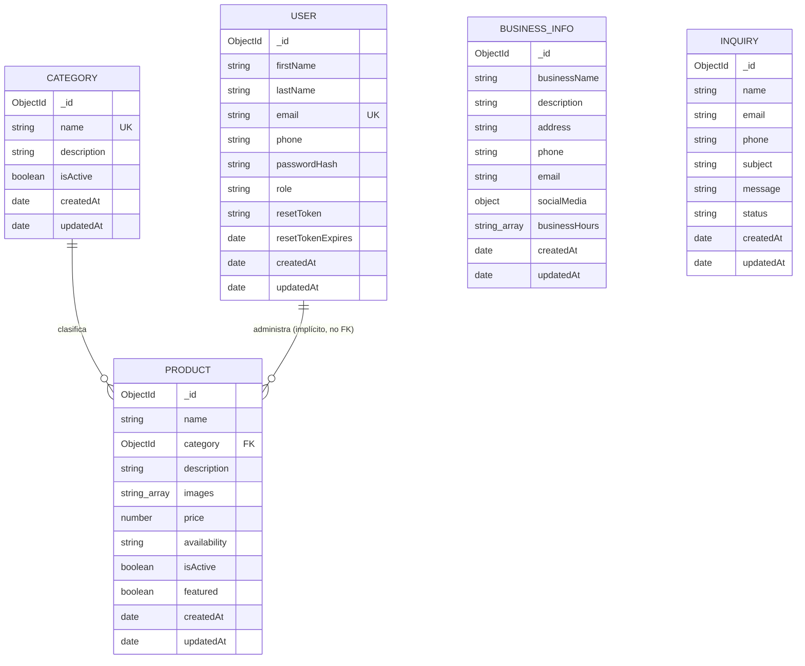

# Modelo de Datos — TecnoStore (MongoDB / Mongoose)

## Diagrama de relaciones

`BUSINESS_INFO` es un documento único (patrón singleton: `GET` devuelve el que exista o `null`, y `PUT` lo crea o lo actualiza). No tiene FK entrantes.

Todas las colecciones usan `timestamps: true` de Mongoose (`createdAt` y `updatedAt` automáticos). Los textos se guardan con `trim` y los emails en minúsculas.

## Colecciones

### `users`
| Campo | Tipo | Notas |
|---|---|---|
| firstName | String | requerido, 2–60 caracteres (validado en la API) |
| lastName | String | requerido, 2–60 caracteres |
| email | String | requerido, único, lowercase, sin espacios, indexado |
| phone | String | requerido, 6–25 caracteres (dígitos, espacios, `+`, `-`, paréntesis) |
| passwordHash | String | requerido, hash bcrypt. Nunca se devuelve (`select: false` + `toJSON` que lo elimina) |
| role | String | enum `['admin']`, default `'admin'` (no lo elige quien se registra) |
| resetToken | String | nullable, hash SHA-256 del token de recuperación (el token "crudo" solo viaja por mail). Se borra al usarlo (un solo uso). Nunca se devuelve |
| resetTokenExpires | Date | nullable, vence 1 hora después de pedirlo. Nunca se devuelve |
| timestamps | — | `createdAt`, `updatedAt` automáticos |

### `categories`
| Campo | Tipo | Notas |
|---|---|---|
| name | String | requerido, único, 2–50 caracteres. La unicidad se valida también sin distinguir mayúsculas (en el service, con una regex anclada) |
| description | String | opcional, hasta 300 caracteres |
| isActive | Boolean | default `true`. Si es `false`, sus publicaciones no aparecen en el sitio público |

El listado de categorías agrega un campo calculado `productCount` (no se guarda en la base).

### `products`
| Campo | Tipo | Notas |
|---|---|---|
| name | String | requerido, 3–120 caracteres |
| category | ObjectId → Category | requerido |
| description | String | requerido, 10–2000 caracteres |
| images | [String] | entre 1 y 8 URLs `http(s)` |
| price | Number | requerido, ≥ 0 |
| availability | String | enum `['disponible','agotado']`, default `'disponible'` |
| isActive | Boolean | default `true` — controla publicación/despublicación |
| featured | Boolean | default `false` |
| timestamps | — | `createdAt`, `updatedAt` |

Índices: `{ category: 1 }`, `{ isActive: 1 }`. El buscador usa una regex (con el texto escapado) sobre `name` y `description`, para permitir búsquedas parciales (`"note"` encuentra `"Notebook"`); por eso ya no se usa índice de texto.

### `businessinfos`
| Campo | Tipo | Notas |
|---|---|---|
| businessName | String | requerido, 2–80 caracteres |
| description | String | opcional, hasta 1000 caracteres |
| address | String | opcional, hasta 150 caracteres |
| phone | String | opcional, mismo formato que el teléfono de usuario |
| email | String | opcional, lowercase. Email de contacto público y destinatario de los avisos de nuevas consultas (si está vacío, se usa `BUSINESS_EMAIL` del `.env`) |
| socialMedia | Object `{ instagram, facebook, whatsapp }` | todos opcionales; instagram/facebook son URLs, whatsapp solo dígitos (8–15) |

En `description`, `address`, `phone`, `email` y las tres redes, un string vacío en el `PUT` borra el dato.
| businessHours | [String] | hasta 10 elementos de hasta 60 caracteres, ej. `["Lun a Vie 9-18", "Sáb 9-13"]` |

Se garantiza a nivel de servicio que solo exista un documento: `GET` devuelve `null` si todavía no se cargó y `PUT` hace upsert (lo crea o lo actualiza).

### `inquiries`
| Campo | Tipo | Notas |
|---|---|---|
| name | String | requerido, 2–80 caracteres |
| email | String | requerido, lowercase |
| phone | String | opcional, mismo formato que el teléfono de usuario |
| subject | String | requerido, 3–120 caracteres |
| message | String | requerido, 10–2000 caracteres |
| status | String | enum `['pendiente','leida','respondida']`, default `'pendiente'` |
| timestamps | — | `createdAt`, `updatedAt` automáticos |

Las validaciones de largo y formato se hacen en la API (express-validator) antes de llegar al modelo.

## Datos precargados (seed)

El "script de creación de la base" es `backend/seed/seed.js` (MongoDB no usa DDL como SQL: las colecciones y los índices los crea Mongoose a partir de los schemas). `npm run seed` limpia las colecciones y carga:

- 1 usuario admin: `admin@tecnostore.com` / `Admin123`.
- 10 categorías activas: Periféricos, Placas de video, Memorias RAM, Procesadores, Motherboards, Fuentes de alimentación, Gabinetes, Almacenamiento, Refrigeración y Monitores.
- **118 productos** (entre 10 y 14 por categoría, definidos en `backend/seed/productos.js`), con precio y la **foto oficial del modelo** con fondo blanco (archivos en `backend/public/productos`, servidos por el back en `/img/productos/<archivo>`), variando `availability` (16 agotados) y `featured` (13 destacados). 2 quedan con `isActive: false` para probar la diferencia entre el listado público y el de administración.
- 1 documento de `BusinessInfo` (con email `contacto@tecnostore.com`).
- 3 consultas de ejemplo, una en cada estado (`pendiente`, `leida`, `respondida`).
