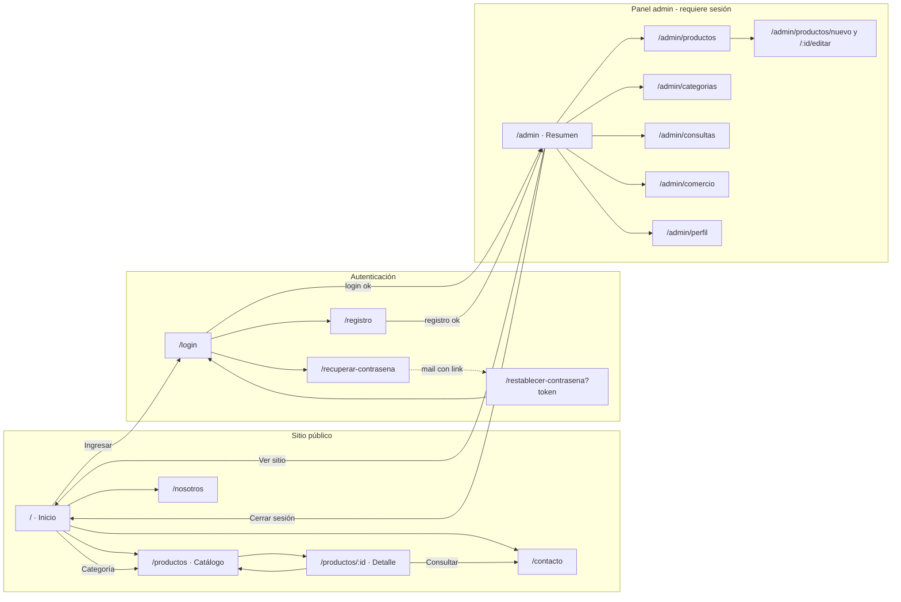

# Spec de Frontend — TecnoStore

Aplicación React (Vite) que consume la API descripta en `03-api-contract.md`. Vive en `frontend/`, separada del backend.

## Stack y criterios

- **Vite + React 18** (JavaScript, sin TypeScript) y **React Router 6**.
- Estado: `useState`, `useEffect`, `useContext` (un `AuthContext`) y algunos custom hooks simples (`useFetch`, `useForm` si suman claridad). Sin Redux, React Query ni librerías de formularios.
- HTTP: `fetch` encapsulado en un único módulo `src/api/client.js`.
- Estilos: **CSS propio**. Variables globales en `styles/variables.css` y un archivo `.module.css` por componente o página. Sin Tailwind ni librerías de componentes.
- Íconos: SVG inline mínimos, escritos a mano en `components/icons.jsx`. **Sin emojis** en ningún lado.
- Animaciones: transiciones de color, borde y fondo de hasta 150ms en hover y foco. La única animación es el fondo de la portada (pistas de circuito con una señal que avanza lento), que se desactiva con `prefers-reduced-motion`. Sin carruseles automáticos, parallax ni animaciones de entrada.
- Código claro y explicable por estudiantes: componentes chicos, nombres en inglés para el código y textos de la UI en español rioplatense.

## Identidad visual: "Ficha técnica"

TecnoStore se presenta como un catálogo técnico: cada producto es una **ficha de especificaciones**. La estética toma elementos de distintas marcas del rubro (las etiquetas industriales de Teenage Engineering, la sobriedad monocroma de Nothing, la grilla de specs de Framework) y la combina con lo que espera el cliente de una tienda argentina como Compra Gamer o Frávega: el precio grande y claro y el estado de stock visible.

### Paleta (`variables.css`)

| Token | Valor | Uso |
|---|---|---|
| `--paper` | `#F3F1EC` | fondo general (papel cálido) |
| `--surface` | `#FFFFFF` | cards, tablas, formularios |
| `--ink` | `#121212` | texto principal, sidebar del admin, botón primario |
| `--ink-2` | `#55524C` | texto secundario |
| `--line` | `#D9D5CC` | bordes hairline de 1px y divisores de grilla |
| `--accent` | `#2340F5` | **único acento** (cobalto): links, foco, precio destacado, indicadores |
| `--accent-ink` | `#FFFFFF` | texto sobre el acento |
| `--ok` | `#1F7A4D` | disponible, "respondida" |
| `--warn` | `#B26A00` | "pendiente" |
| `--danger` | `#C2361F` | errores, eliminar, agotado |

Contraste AA verificado para el texto sobre `--paper` y `--surface`.

**Solo se usan estos tokens.** Los estados de hover se definen también como tokens en `variables.css`: `--surface-hover` (`#FBFAF7`), `--ink-hover` (`#2B2B2B`), `--accent-hover` (`#1A32CC`) y, para la sidebar del admin, `--ink-line` (`#2E2E2E`) y `--ink-muted` (`#9D9A93`). No hay colores sueltos en los `.module.css`, salvo la transparencia del overlay del modal.

**Botones:**
- `primary` (cobalto `--accent`): la acción principal de cada pantalla, **una sola por vista**. Por ejemplo "Ver catálogo", "Consultar por este producto", "Enviar consulta", "Guardar", "Ingresar".
- `dark` (`--ink`): acciones fuertes secundarias o compactas, como "Buscar", "Escribinos", "Ingresar" del navbar y "Nueva publicación".
- `secondary` (borde 1px, fondo `--surface`): el resto.
- `danger`: solo para eliminar.

### Tipografía
Google Fonts:
- **"Archivo"** (400, 500, 700) para títulos y texto.
- **"JetBrains Mono"** (400, 500) para etiquetas, códigos, precios, contadores y metadatos.

Escala: 12 / 14 / 16 / 20 / 28 / 40 px. Las etiquetas van en mono, en MAYÚSCULAS, con un `letter-spacing` de 0.06em y 12px.

### Lenguaje gráfico
- Bordes de 1px `--line` y radio de 2px (4px como máximo). Sombras casi nulas: solo en los modales.
- **Grillas con divisores**: las cards comparten bordes, como una tabla de specs, en lugar de flotar separadas.
- **Indicador de estado**: un cuadrado de 8px, lleno (`--ok`) si está disponible y solo con borde (`--danger`) si está agotado, seguido del texto en mono.
- **Fechas**: formato `6 de nov de 2026` (`Intl.DateTimeFormat('es-AR', { day: 'numeric', month: 'short', year: 'numeric' })`); en las listas del admin, `06/11/2026 14:30`.
- **Precio**: mono, grande, con `Intl.NumberFormat('es-AR', { style: 'currency', currency: 'ARS', maximumFractionDigits: 0 })`.
- **Encabezados de sección**: título + regla de 1px, sin numeración (solo se muestran números que son datos: precio, teléfono, cantidades).
- **Imágenes**: contenedor con relación 4:3; la foto (de catálogo, con fondo blanco) se muestra entera con `object-fit: contain` sobre `--surface`. Si la imagen falla (`onError`) se muestra un placeholder con el nombre de la categoría, sin imagen rota.

### Responsive
Mobile-first, con breakpoints en 640px, 960px y 1200px y un ancho máximo de contenido de 1200px con gutter de 16px en mobile y 24px en desktop.
- **Navbar:** en mobile tiene botón "Menú" (texto + icono SVG) que despliega la navegación.
- **Grilla de productos:** **2 columnas ya en mobile** (cards compactas: precio un poco más chico, el estado se muestra solo con el indicador cuadrado y un texto corto), 3 desde 960px. 4 desde 1200px solo donde no hay sidebar de filtros (en el home); en el catálogo, con la sidebar, quedan 3. La grilla de categorías del home también va en 2 columnas en mobile.
- **Admin:** la sidebar pasa a una barra superior con menú desplegable debajo de 960px. Las tablas se convierten en listas de tarjetas debajo de 640px.

### Accesibilidad
- `label` asociado a cada input y `aria-invalid` + `aria-describedby` en los errores.
- Foco visible (outline de 2px `--accent`).
- Botones reales (`<button>`) para las acciones y `alt` en las imágenes.
- Los modales cierran con Escape y devuelven el foco.

## Estructura

```
frontend/
  index.html
  vite.config.js
  .env.example             VITE_API_URL=http://localhost:4000/api
  src/
    main.jsx · App.jsx (definición de rutas)
    api/          client.js · auth.js · products.js · categories.js · inquiries.js · businessInfo.js · stats.js
    context/      AuthContext.jsx
    hooks/        useFetch.js · useForm.js · useDocumentTitle.js
    components/   Button · Field (input/textarea/select con label y error) · Modal · ConfirmDialog
                  Spinner · EmptyState · ErrorState · Pagination · StatusBadge · AvailabilityIndicator
                  ProductCard · ProductGallery · SectionHeader · Toast (ToastContext) · ProtectedRoute
                  ImageWithFallback · icons.jsx
    layouts/      PublicLayout (Navbar + Footer) · AdminLayout (Sidebar + Topbar) · AuthLayout
    pages/
      public/     HomePage · CatalogPage · ProductDetailPage · AboutPage · ContactPage · NotFoundPage
      auth/       LoginPage · RegisterPage · ForgotPasswordPage · ResetPasswordPage
      admin/      DashboardPage · ProductsPage · ProductFormPage · CategoriesPage
                  InquiriesPage · BusinessInfoPage · ProfilePage
    styles/       variables.css · global.css
    utils/        format.js (precio y fechas) · validators.js
```

### Comportamiento transversal
- **`api/client.js`:**
  - Arma la URL con `VITE_API_URL` y agrega `Authorization: Bearer <token>` si hay sesión.
  - Parsea el JSON y, si la respuesta no es ok, lanza un `ApiError` con `status`, `message` y `fieldErrors` (un objeto `{campo: mensaje}` armado a partir de `errors[]`).
  - Ante un **401 en un request autenticado** limpia la sesión y redirige a `/login?expired=1`.
- **`AuthContext`:**
  - Guarda `token` y `user` en localStorage, en try/catch.
  - Expone `login`, `logout`, `updateUser` e `isAuthenticated`.
  - Al montar, si hay token, valida contra `GET /auth/me`.
- **`ProtectedRoute`:** sin sesión redirige a `/login?next=<ruta>`; después del login vuelve a `next`.
- **Formularios:**
  - Validación en el front con `utils/validators.js`, usando las **mismas reglas que el backend** (largos, formato de email y teléfono, contraseña ≥8 con letra y número).
  - Errores debajo de cada campo, al hacer blur y al enviar.
  - Los `fieldErrors` del backend se muestran en los mismos lugares.
  - El botón de envío queda deshabilitado mientras se envía y muestra "Guardando…".
- **Estados:** cada pantalla que trae datos muestra cargando (`Spinner`: `role="status"` con el texto "Cargando…" y un cuadrado que rota; es la **única** animación permitida, y se desactiva con `prefers-reduced-motion`), error con "Reintentar" (`ErrorState`) y vacío (`EmptyState`).
- **Feedback:** toasts discretos (abajo a la derecha, 4s, sin animación de entrada) para las acciones exitosas y los errores generales.
- **Título del documento** por página (`useDocumentTitle`): `<Sección> · TecnoStore` ("Catálogo · TecnoStore", "Contacto · TecnoStore", "Publicaciones · Panel · TecnoStore"); en el detalle, `<Nombre del producto> · TecnoStore`; en el home, solo "TecnoStore".
- **Scroll al tope** al cambiar de ruta.

## Rutas y pantallas

### Sitio público (`PublicLayout`)

| Ruta | Pantalla | Contenido |
|---|---|---|
| `/` | Home | Bloque de presentación a todo el ancho, con fondo de pistas de circuito en SVG (`HeroLines.jsx`), el nombre y la descripción del comercio y los botones "Ver catálogo" y "Hacer una consulta". "Destacados": carrusel manual (`ProductCarousel`, con flechas o deslizando) de productos con `featured=true` (hasta 8). "Categorías": grilla de categorías con `productCount`, que linkea a `/productos?categoria=<id>`. |
| `/productos` | Catálogo | Buscador (submit con Enter o botón; se aplica 300ms después de dejar de tipear, con debounce simple en un `useEffect`). Filtros: categoría, disponibilidad, rango de precio (mín./máx.) y orden. En desktop van en una columna lateral; en mobile, en un panel que se despliega con "Filtros". Contador `27 resultados`, chips de filtros activos con "Limpiar". Grilla de `ProductCard` y paginación. **Los filtros viven en la URL** (`useSearchParams`) para poder compartir y volver atrás, con estos nombres de parámetro: `q`, `categoria`, `disponibilidad` (`disponible`/`agotado`), `min`, `max`, `orden` (`recent`/`price_asc`/`price_desc`/`name_asc`) y `pagina`. Categoría, disponibilidad y orden son `<select>`; mín./máx. son `<input type="number">`. |
| `/productos/:id` | Detalle | Breadcrumb (Catálogo / Categoría / Producto). `ProductGallery` con imagen principal y miniaturas clickeables. Ficha: nombre, categoría (link), estado, precio, descripción y tabla de "Especificaciones" con Categoría, Disponibilidad y Publicado. CTA "Consultar por este producto" que lleva a `/contacto?producto=<id>`. Debajo, "Más de <categoría>" con hasta 4 productos de la misma categoría. 404 propio si no existe. |
| `/nosotros` | Nosotros | Descripción del comercio y ficha con dirección, teléfono, email, horarios y redes (links reales con `rel="noopener noreferrer"`; WhatsApp a `https://wa.me/<numero>`). |
| `/contacto` | Contacto | Formulario (nombre, email, teléfono opcional, asunto, mensaje con contador de caracteres) más los datos de contacto al costado. Si viene `?producto=<id>`, precarga el asunto "Consulta por <nombre>". Al enviar con éxito muestra una confirmación en la misma página ("Recibimos tu consulta. Te enviamos una copia a <email>.") con la opción de enviar otra. |
| `*` | 404 | Mensaje sobrio con links a Home y Catálogo. |

**Navbar:** wordmark "TECNOSTORE" en mono con un cuadrado de acento; links Inicio, Catálogo, Nosotros y Contacto; buscador compacto (se envía con Enter, sin botón) que lleva a `/productos?q=...`. A la derecha, "Ingresar" o, con sesión, "Panel" y "Salir".
**Footer:** datos del comercio, links y redes.

### Autenticación (`AuthLayout`: panel centrado sobre `--paper` con el wordmark)

| Ruta | Pantalla |
|---|---|
| `/login` | Email y contraseña (con botón "Mostrar"). Link a "¿Olvidaste tu contraseña?" y a "Crear cuenta". Si viene `?expired=1`, avisa "Tu sesión expiró". |
| `/registro` | Nombre, apellido, email, teléfono, contraseña y confirmación, con las reglas de la contraseña visibles. Al registrarse, inicia sesión automáticamente y entra al panel. |
| `/recuperar-contrasena` | Email. Al enviar, muestra el mensaje genérico del backend. |
| `/restablecer-contrasena?token=...` | Nueva contraseña y confirmación. Si el token es inválido o expiró, ofrece pedir un link nuevo. Si sale bien, lleva a `/login` con aviso. |

Con sesión iniciada, `/login` y `/registro` redirigen a `/admin`.

### Panel de administración (`AdminLayout` dentro de `ProtectedRoute`)

Sidebar `--ink` con wordmark; secciones Resumen, Publicaciones, Categorías, Consultas (con un contador de pendientes), Comercio y Mi perfil; "Ver sitio" (abre `/` en otra pestaña) y "Cerrar sesión". Topbar con el título de la sección y el nombre del usuario.

| Ruta | Pantalla |
|---|---|
| `/admin` | **Resumen** (`GET /stats`): fichas con número grande en mono (publicaciones activas/inactivas, agotadas, destacadas, consultas pendientes); barras horizontales simples en CSS con las publicaciones por categoría (sin librerías de gráficos); tabla de las últimas 5 consultas con link. |
| `/admin/productos` | Tabla con miniatura, código, nombre, categoría, precio, disponibilidad, destacado y estado (Publicada/Oculta). Filtros: búsqueda, categoría, estado, disponibilidad. Acciones por fila: Editar, Publicar/Ocultar (toggle inmediato con toast) y Eliminar (con `ConfirmDialog`). Botón "Nueva publicación". Paginación. |
| `/admin/productos/nuevo`, `/admin/productos/:id/editar` | **Un mismo formulario** (`ProductFormPage`): nombre, categoría (select de todas), descripción (con contador), precio, disponibilidad (radio), destacado y publicada (checkboxes), **imágenes**: lista de URLs con agregar, quitar y reordenar (subir/bajar), hasta 8, con vista previa. La primera es la principal. Validación según el contrato. Guarda y vuelve al listado con toast. Avisa si hay cambios sin guardar al salir con "Cancelar". |
| `/admin/categorias` | Tabla: nombre, descripción, cantidad de publicaciones, estado (activa/inactiva con toggle). Crear y editar en `Modal`. Eliminar se deshabilita, con tooltip/texto, si tiene publicaciones, y el 409 del backend también se muestra. |
| `/admin/consultas` | Pestañas por estado (Todas, Pendientes, Leídas, Respondidas) con contadores y búsqueda. Lista de consultas con fecha, nombre, asunto y estado. Al hacer click se abre el detalle en un panel lateral (desktop) o en una página o modal (mobile) con el mensaje completo, el email (`mailto:` con el asunto "Re: ...") y el teléfono. Al abrir una pendiente se marca como **leída** automáticamente. Selector de estado y Eliminar con confirmación. |
| `/admin/comercio` | Formulario de información institucional: nombre, descripción, dirección, teléfono, email, Instagram, Facebook, WhatsApp, y horarios como lista editable de líneas (agregar/quitar). Vista previa de cómo se ve en `/nosotros` (opcional). |
| `/admin/perfil` | Dos bloques: "Datos personales" (nombre, apellido, email, teléfono) y "Cambiar contraseña" (actual, nueva, confirmación). Cada uno con su propio botón Guardar. |

## Diagrama de navegación



## Textos fijos de la UI

Para que el front, los tests E2E y la documentación usen exactamente los mismos nombres:

| Lugar | Texto |
|---|---|
| Navbar | Inicio · Catálogo · Nosotros · Contacto · Ingresar · Panel · Salir · botón mobile "Menú" · buscador compacto con label "Buscar en la tienda" (se envía con Enter) |
| Catálogo | label del buscador "Buscar productos" (distinto del navbar para no duplicar labels en la misma página) · filtros de precio sin botón "Aplicar": se aplican con el mismo debounce de 300ms · botón "Buscar" · botón mobile "Filtros" · labels "Categoría", "Disponibilidad", "Precio mínimo", "Precio máximo", "Ordenar por" · "Limpiar filtros" · contador "N resultados" (o "1 resultado") |
| Paginación | "Anterior" · "Siguiente" · "Página X de Y" |
| Detalle | "Consultar por este producto" · tabla "Especificaciones" · sección "Más de <categoría>" |
| Contacto | labels "Nombre", "Email", "Teléfono (opcional)", "Asunto", "Mensaje" · botón "Enviar consulta" / "Enviando…" · "Enviar otra consulta" |
| Auth | labels "Email", "Contraseña", "Confirmar contraseña", "Nombre", "Apellido", "Teléfono", "Nueva contraseña" · botones "Ingresar", "Crear cuenta", "Enviar instrucciones", "Restablecer contraseña", "Mostrar"/"Ocultar" |
| Formularios del admin | "Guardar" / "Guardando…" · "Cancelar" · "Eliminar" · "Editar" |
| Publicaciones | "Nueva publicación" · "Publicar"/"Ocultar" · estado "Publicada"/"Oculta" |
| Formulario de publicación | labels "Nombre", "Categoría", "Descripción", "Precio", "Disponibilidad" (radios "Disponible"/"Agotado"), checkboxes "Destacado" y "Publicada" · imágenes: un textbox por URL con label "Imagen 1", "Imagen 2"…, botones por fila "Subir", "Bajar", "Quitar" (con `aria-label` "Subir imagen 2", etc.) y "Agregar imagen" · salir con cambios sin guardar abre un `ConfirmDialog` "Descartar cambios" |
| Categorías | "Nueva categoría" · "Activar"/"Desactivar" |
| Consultas | pestañas "Todas", "Pendientes", "Leídas", "Respondidas" · label "Estado" · "Responder por email" |
| Resumen (fichas) | "Publicaciones activas", "Publicaciones ocultas", "Agotadas", "Destacadas", "Consultas pendientes" · sección "Publicaciones por categoría" · "Últimas consultas" |
| ConfirmDialog | título con la acción · botones "Confirmar" y "Cancelar" |
| Sidebar admin | Resumen · Publicaciones · Categorías · Consultas · Comercio · Mi perfil · Ver sitio · Cerrar sesión |
| Categorías (modal) | labels "Nombre", "Descripción (opcional)", checkbox "Activa" · si tiene publicaciones, Eliminar queda deshabilitado con el texto "No se puede eliminar: tiene N publicaciones" |
| Comercio | labels "Nombre del comercio", "Descripción", "Dirección", "Teléfono", "Email", "Instagram", "Facebook", "WhatsApp" · horarios: textboxes "Horario 1", "Horario 2"… con "Quitar horario N" y "Agregar horario" |
| Perfil | sección "Datos personales" (labels "Nombre", "Apellido", "Email", "Teléfono") · sección "Cambiar contraseña" (labels "Contraseña actual", "Nueva contraseña", "Confirmar contraseña") |
| Buscadores del admin | label "Buscar" |
| 404 | h1 "Página no encontrada" · links "Ir al inicio" y "Ver catálogo" |
| Estado vacío | catálogo: "No encontramos productos con esos filtros" · listados del admin: "Todavía no hay <recurso>" |
| Mensajes | email duplicado: el `message` del backend tal cual · token inválido: "El enlace no es válido o ya venció." + link "Pedir un enlace nuevo" · después del reset: aviso "Tu contraseña se actualizó. Ya podés ingresar." en `/login` |

**Values de los `<select>`:** siempre los valores del contrato o de la URL (`price_asc`, `agotado`, `respondida`, el `_id` de la categoría); el texto visible va en español.

Cada página tiene un único `<main>`, un `<h1>` y navegación con `<nav aria-label="...">`.
